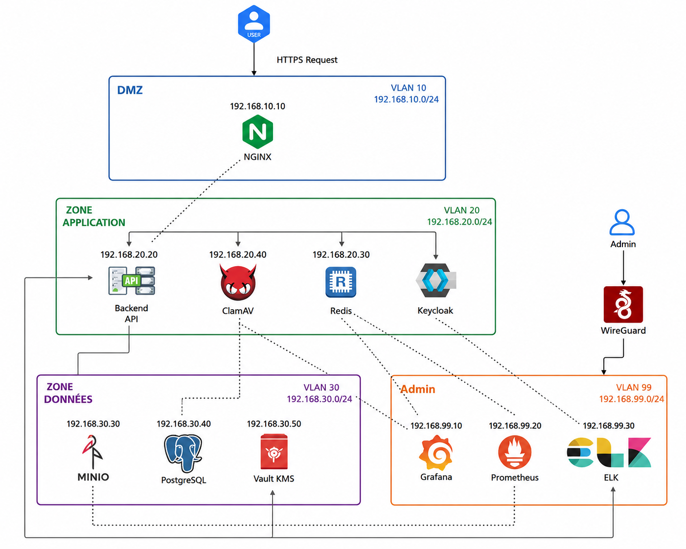
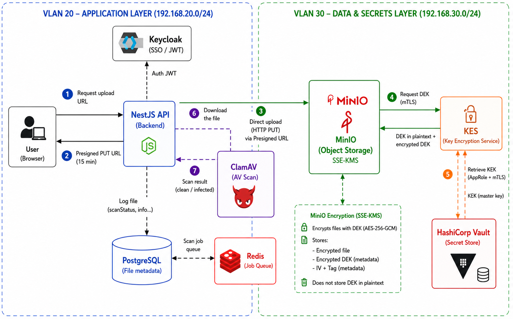
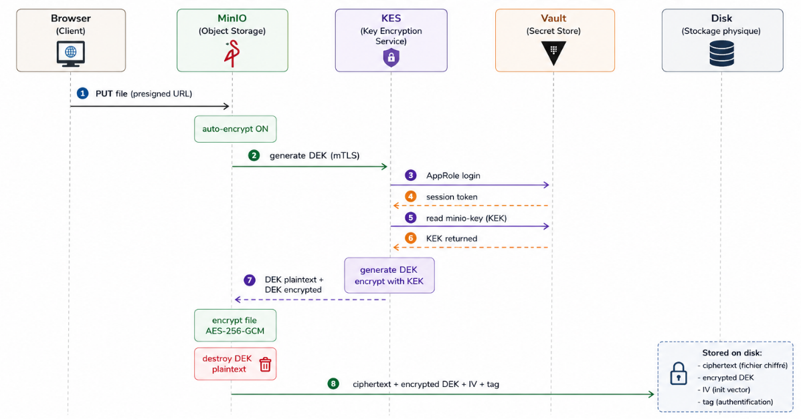

# PURA Drive — Secure Internal File Storage & Security Monitoring Platform

> **Zero Trust | Network Segmentation | IAM | Encryption | Malware Protection | SIEM | DevSecOps**

PURA Drive is a secure internal file storage and collaboration platform designed with a **Security by Design** approach.

The project combines secure file management, identity and access management, encrypted storage, malware detection, centralized logging, monitoring, and DevSecOps practices within a segmented network architecture.

---

## 📌 Project Overview

The objective of PURA Drive is to provide a secure platform for storing, sharing, and managing files while protecting them against:

- Unauthorized access
- Malware and infected files
- Data exposure
- Credential compromise
- Lateral movement
- Unauthorized administrative access

The platform integrates security controls throughout the entire file lifecycle, from authentication and upload to storage, scanning, monitoring, and administration.

---

## 🎯 Objectives

The main objectives of the project are:

- Implement **Zero Trust security principles**
- Secure user authentication and authorization
- Protect stored files using **encryption**
- Detect and block **malicious files**
- Implement **role-based access control**
- Centralize security and audit logs
- Monitor infrastructure and security events
- Apply **network segmentation**
- Integrate security into the development lifecycle
- Provide secure file sharing and collaboration

---

## 🏗️ Architecture



The architecture is based on several security layers:

- Reverse proxy and TLS termination with **Nginx**
- Identity and access management with **Keycloak**
- Application services based on **Next.js** and **NestJS**
- PostgreSQL for application data
- Redis and Bull Queue for asynchronous processing
- MinIO for object storage
- Vault and KES for encryption key management
- ClamAV for malware detection
- ELK/Kibana for centralized logging and security monitoring
- Prometheus and Grafana for infrastructure monitoring
- WireGuard for secure administrative access

---

## 🔐 Identity & Access Management

PURA Drive uses **Keycloak** to centralize authentication and authorization.

Security mechanisms include:

- OpenID Connect (OIDC)
- Single Sign-On (SSO)
- Role-Based Access Control (RBAC)
- Multi-Factor Authentication (MFA)
- TOTP-based authentication
- User and role management

### Multi-Factor Authentication

The authentication workflow combines user login and MFA verification.


---

## 🔒 Secure File Storage

Files are stored using **MinIO** and protected through an encryption architecture based on **Vault** and **KES**.

The platform uses:

- MinIO object storage
- Vault for key management
- KES as the key management service
- AES-256-GCM encryption
- mTLS communication between components
- Encryption keys separated from stored data

### Encryption Architecture



The encryption mechanism follows an envelope encryption approach where encryption keys are securely managed separately from the stored files.

---

## 📤 Secure File Upload

Files are uploaded directly from the browser to MinIO using a **presigned URL** generated by the backend.

This prevents the application server from unnecessarily handling the file content.



### Upload Workflow

```text
User
  │
  ▼
Frontend
  │
  ▼
NestJS API
  │
  │ Generate presigned URL
  ▼
MinIO
  │
  ▼
KES
  │
  ▼
Vault
```

---

## 🦠 Malware Detection

Uploaded files are asynchronously scanned using **ClamAV**.

The scanning process is handled through a background job architecture using **Redis/Bull Queue**.

### Malware Detection Demo

The demo shows the complete malware detection workflow:

**Upload infected file → Scan status → Admin alert**


### Detection Workflow

```text
File Upload
     │
     ▼
MinIO
     │
     ▼
Bull / Redis Queue
     │
     ▼
ClamAV Scan
     │
     ├── Clean
     │     └── File remains available
     │
     └── Infected
           ├── File deleted
           ├── Status updated
           ├── User notified
           └── Admin alerted
```

---

## 📁 File Management & Team Collaboration

PURA Drive provides secure file management and collaboration features.

The interface includes:

- File and folder management
- List and grid views
- File search
- Filtering
- Folder organization
- Team workspaces
- Team members
- Role-based collaboration
- Secure file sharing


---

## 👨‍💼 Administration

The administration interface provides centralized management of the platform.

Administrators can monitor and manage:

- Users
- Files
- Teams
- Security-related events
- Platform activity


---

## 📊 Security Monitoring — Kibana

PURA Drive integrates the **ELK Stack** to centralize and analyze application and security logs.

Kibana provides visibility into:

- Security events
- Authentication events
- File activity
- Audit logs
- Application activity

### Kibana Dashboard


---

## 📈 Infrastructure Monitoring — Grafana

Prometheus and Grafana are used to monitor the infrastructure and platform health.

Monitoring includes:

- System metrics
- Application metrics
- Resource usage
- Service health
- Security-related metrics

### Grafana Dashboard


---

## ⚙️ DevSecOps

Security is integrated into the development and CI/CD lifecycle.

The project includes security testing and analysis using:

- **GitHub Actions**
- **Gitleaks**
- **Semgrep**
- **OWASP ZAP**

The objective is to detect security issues early during development and deployment.

---

## 🛡️ Security Principles

PURA Drive follows several security principles:

### Zero Trust

Access is continuously controlled based on identity, role, and authorization.

### Defense in Depth

Multiple security layers are combined:

```text
Network Segmentation
        ↓
Nginx / TLS
        ↓
Identity & MFA
        ↓
RBAC
        ↓
Encrypted Storage
        ↓
Malware Detection
        ↓
SIEM / Logging
        ↓
Monitoring
```

### Security by Design

Security controls are integrated directly into the architecture rather than added as an afterthought.

---

## 🔄 Security Workflows

### Authentication

```text
User
 ↓
Login
 ↓
Keycloak
 ↓
MFA / TOTP
 ↓
OIDC Token
 ↓
Application
```

### Secure Storage

```text
User
 ↓
Frontend
 ↓
Presigned URL
 ↓
MinIO
 ↓
KES
 ↓
Vault
 ↓
Encrypted Object
```

### Malware Detection

```text
Upload
 ↓
MinIO
 ↓
Redis / Bull Queue
 ↓
ClamAV
 ↓
Detection Result
 ↓
User Notification / Admin Alert
```

### Security Monitoring

```text
Application
     │
     ├── Security Logs
     ├── Audit Logs
     └── Application Logs
              │
              ▼
             ELK
              │
              ▼
            Kibana
```

---

## 🧰 Technology Stack

| Category | Technologies |
|---|---|
| Frontend | Next.js |
| Backend | NestJS / TypeScript |
| Database | PostgreSQL |
| Cache / Queue | Redis / Bull |
| Identity | Keycloak |
| Object Storage | MinIO |
| Key Management | Vault / KES |
| Encryption | AES-256-GCM |
| Antivirus | ClamAV |
| Logging / SIEM | ELK / Kibana |
| Monitoring | Prometheus / Grafana |
| Reverse Proxy | Nginx |
| VPN | WireGuard |
| Containers | Docker / Docker Compose |
| CI/CD | GitHub Actions |
| Security Testing | Gitleaks / Semgrep / OWASP ZAP |

---

## 🎓 Academic Project

**ENET'COM — Sfax, Tunisia**

**Telecommunications Engineering — Telecommunications Technologies and Services**

This project was developed as part of the final-year engineering project (PFE), focusing on **cybersecurity, secure infrastructure, identity management, data protection, malware detection, and security monitoring**.

---

## 👩‍💻 Author

**Oumayma Selmi**

Telecommunications Engineering Graduate — Cybersecurity

- 🔗 LinkedIn: [Oumayma Selmi](https://www.linkedin.com/in/oumayma-selmi-74b3ab284/)
- 💻 GitHub: [aumayma](https://github.com/aumayma)

---

## 🚀 Project Focus

**Secure Storage · Zero Trust · IAM · Encryption · Malware Detection · SIEM · Monitoring · DevSecOps**
